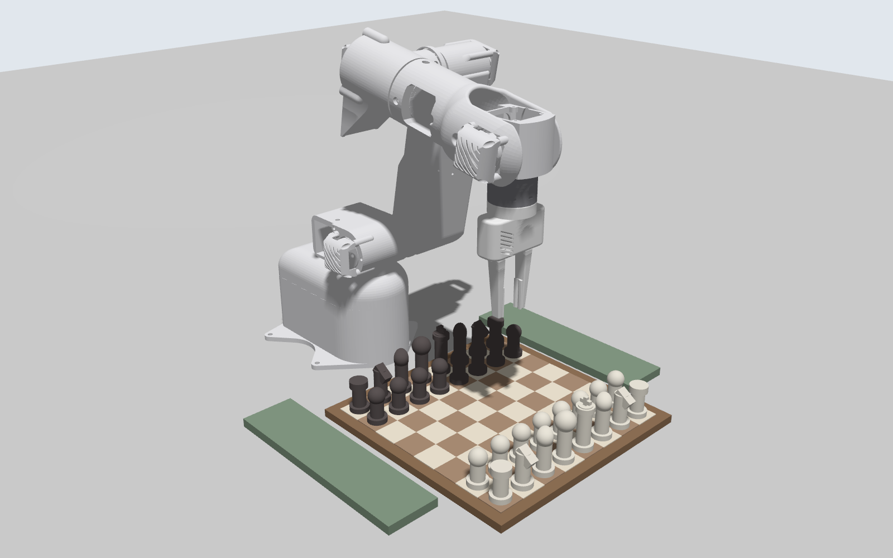

# NewtonBotic Arm: Simulated Chess-Playing Robot

The HELENE 6-DOF arm with a parallel-jaw gripper plays chess against a human in Gazebo Sim, with MoveIt 2 for motion planning. The robot model comes from `helene_description`, vendored in `src/helene_description` (see its `VENDORED.md`).

Stack: ROS 2 Jazzy · Gazebo Harmonic (gz sim 8) · ros2_control · MoveIt 2 · python-chess (+ Stockfish, optional)



*Gazebo Harmonic (headless Ogre2 render): HELENE at `ready`, gripper open, standard start position.*

## Status

| Phase | State |
|---|---|
| 0 Audit | Done. See [docs/PROJECT_AUDIT.md](docs/PROJECT_AUDIT.md) |
| 1 Robot description | HELENE arm + gripper (generated from Fusion CAD), wrapped with project ros2_control and Gazebo files |
| 2 Gripper | Done. Two commanded prismatic fingers (no mimic), jaw gap = 2 × finger value, 0–40 mm |
| 3 Chess world | Done. Generated board and 32 pieces, reset, promotion swap |
| 4 MoveIt 2 | Done. Arm group joint1–6 to `tcp`, gripper group, ACM regenerated |
| 5 Pick and place | Done with **real pure-friction grasps** (verified in Gazebo) |
| 6 Game controller | Done. Validate → execute → verify whole board → commit; Stockfish |
| 7 End-to-end loop | Done (human move + robot reply executed with the real gripper) |
| 8 Special moves | Captures, castling, en passant and promotion are planned, and tested in sim |

`execution_mode:=teleport` remains as a **test-only** mode. The arm moves for real, but pieces are moved by Gazebo `set_pose`. It is useful for debugging game flow apart from grasping.

## Setup

```bash
sudo apt install stockfish                      # optional; without it a simple fallback policy plays
pip install --user --break-system-packages chess   # python-chess (no apt package on Ubuntu 24.04)

cd ~/NewtonBotic_Arm
source /opt/ros/jazzy/setup.bash
rosdep install --from-paths src --ignore-src -r -y
colcon build --symlink-install
source install/setup.bash
```

## Run

```bash
# Full system: Gazebo + arm + MoveIt + manipulation + game (add headless:=true rviz:=false for no GUI)
ros2 launch robot_bringup chess_game.launch.py

# About 5 s after the arm stack is ready, a startup demo runs: the arm picks the e2 pawn,
# places it on e4, then carries it back to e2. Options:
#   startup_demo:=false   demo_delay:=5.0   demo_move:=e2e4   demo_return:=true

# In a second terminal: play as white
ros2 run chess_game play
#   your move> e4        (UCI or SAN; also: board, new, quit)
```

Other entry points:

| Command | Purpose |
|---|---|
| `ros2 launch robot_description display.launch.py` | RViz + joint sliders, no simulation |
| `ros2 launch robot_bringup gazebo.launch.py headless:=true` | Arm and controllers in an empty world |
| `ros2 launch robot_bringup sim_moveit.launch.py` | The above plus MoveIt |
| `ros2 launch robot_bringup chess_sim.launch.py` | Chess world plus MoveIt, no game |
| `ros2 run chess_manipulation reachability` | IK reachability of every square |
| `ros2 run chess_manipulation motion_check` | MoveIt plan/execute accuracy test |
| `python3 tools/integration_scenarios.py` | Capture, castling, promotion and failure scenarios |
| `ros2 service call /chess_world/reset std_srvs/srv/Trigger` | Restore the start position |

Tests: `colcon test --packages-select chess_simulation chess_game && colcon test-result --verbose`

## Architecture

```
chess_game (rules, engine, commit)            chess_simulation (world)
   │  /execute_moves (action)                    world_interface: /chess_world/{get_piece_states,
   ▼                                               reset, replace_piece, set_piece_pose}
chess_manipulation (pick/place stages) ──────►  board.py + config/board.yaml  ◄── single source
   │  move_group services/actions                  of square ↔ world geometry
   ▼
newtonbotic_moveit_config ──► arm_controller (JTC) ──► gz_ros2_control ──► Gazebo
robot_description (URDF/Xacro)     robot_bringup (launch, controllers.yaml)
chess_interfaces (PieceMove, PieceState, ExecuteMoves, SubmitMove, …)
```

- **Game.** Every move, the human's or the robot's, runs as one transaction:
  1. Validate the move with python-chess.
  2. Plan the piece moves (REMOVE, MOVE, REPLACE).
  3. Execute them.
  4. Compare the **whole** observed board against the expected one.
  5. Commit.

  If anything fails, the last committed state is kept.
- **Manipulation.** Each piece move runs these stages: VALIDATE → PRE_GRASP → OPEN → APPROACH → CLOSE → VERIFY_GRASP → LIFT → VERIFY_LIFT → TRANSFER → LOWER → RELEASE → RETREAT → VERIFY_PLACE.
  - A failure returns its stage, a category (INVALID, PLANNING, CONTROLLER, GRASP, RELEASE, VERIFY, WORLD or CANCELLED) and a message.
  - Free-space motion uses OMPL. Vertical motion and level transfer use Cartesian paths.
  - The board, the trays and every piece are in the MoveIt planning scene, and a held piece is attached to `tcp`.

### Board convention (`chess_simulation/config/board.yaml`)

- `chessboard_frame`:
  - **Origin:** the centre of the board's top surface.
  - **+X:** toward the h-file.
  - **+Y:** toward rank 8.
  - **Square centres:** `((f-3.5)s, (r-3.5)s)`.
- The squares are 30 mm, scaled down to the arm's reach.
- The board centre is at world (0.22, 0), in front of the arm along +X. It is rotated +90°, so **rank 8 faces the robot**: the robot plays black and the human sits at rank 1.
- Captured pieces go to two 2×8 trays beside the board.
- Piece IDs are stable, e.g. `white_pawn_e2`. Promoted pieces get IDs like `white_queen_promo1`.

## Robot model (HELENE)

- **Chain:** `world → base_link → link1…link6 → gripper_base → finger_r / finger_l + tcp`.
- **Joints:**
  - `joint1`–`joint6` are revolute.
  - `finger_r_joint` and `finger_l_joint` are prismatic, 0–0.02 m each, positive = open.
- **Zero pose:** an "L" (upper arm vertical, forearm along +X).
- **`ready` pose:** [0, 11, 0.46, 0, −79.46, 0]° puts the TCP at (0.232, 0, 0.150), pointing down. This is the rest pose between moves.
- **Tool frame:** `tcp`, between the pads. Its **+X axis is the approach direction** and +Y is the jaw axis.
- **Gripper command:** publish `std_msgs/Float64MultiArray` `[v, v]` to `/gripper_controller/commands`. Jaw gap = 2v.
- **Generated files:** `helene_description.xacro` and the meshes are generated upstream, so don't edit them here. Regenerate in the source repo, then run `tools/sync_helene_description.sh <checkout>`.
- **Limits:** effort and velocity limits are CAD design estimates.
